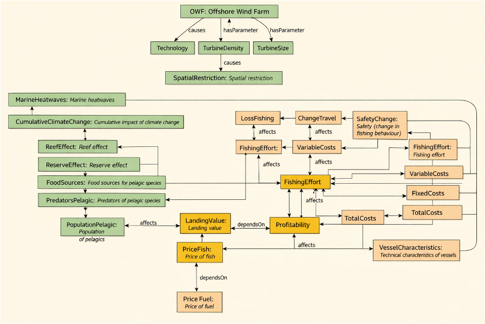
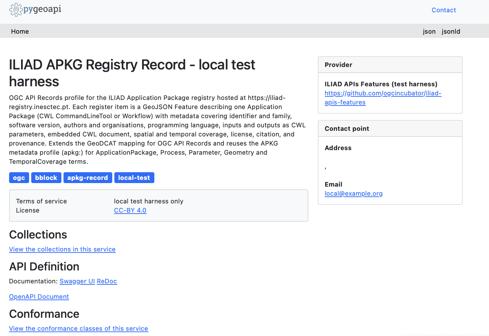
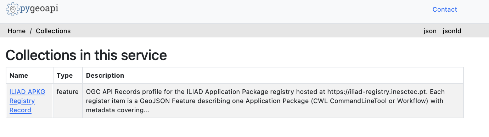
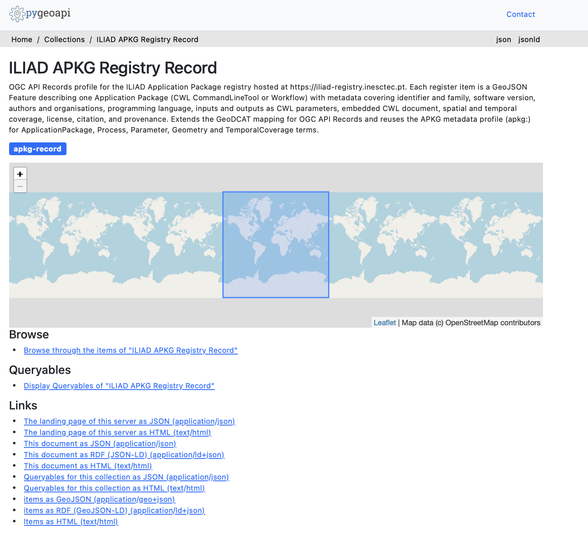
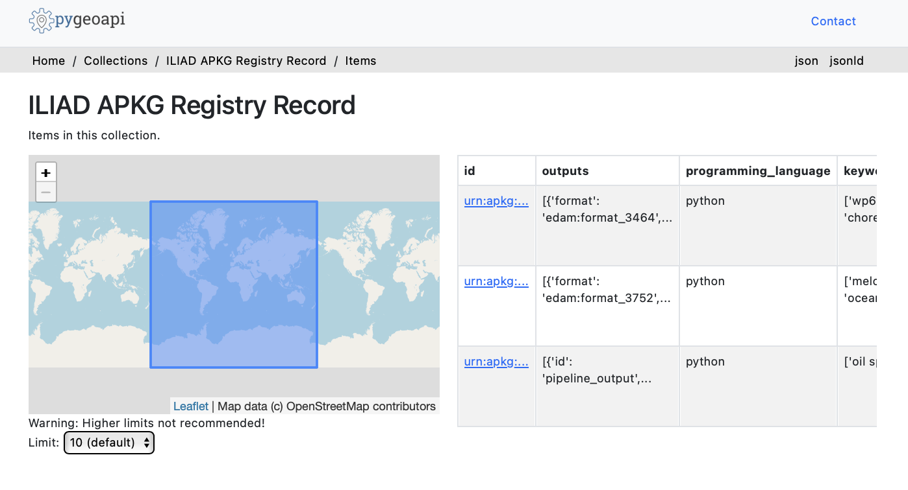
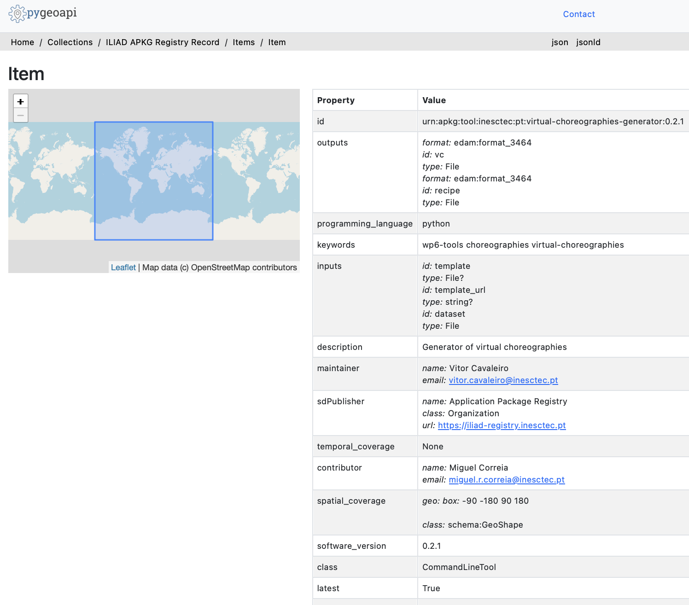
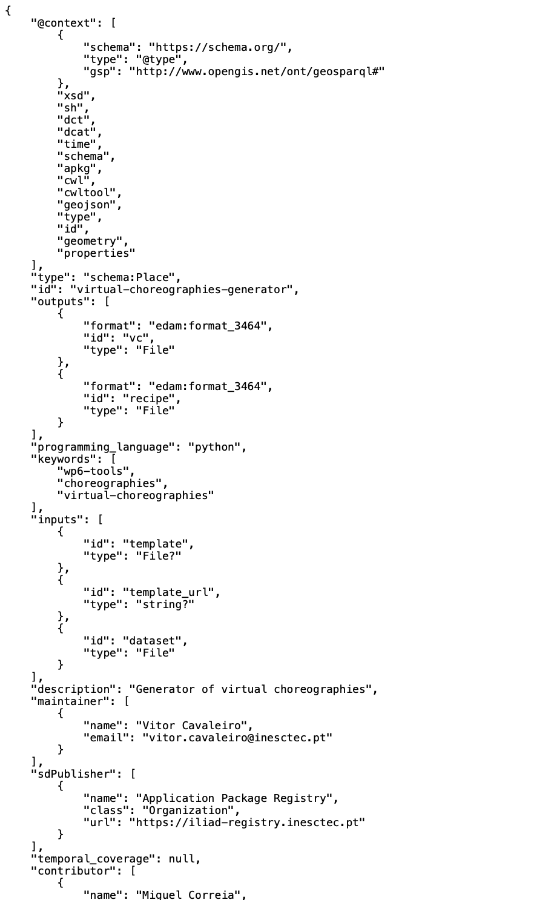

# Case definition

I try to provide description of the model that will calculate impact of the windpark deployment next to the Utsira Island (Norway)/ north to Gottland/Sweden on fishing.
There are several potential setups with different number of turbines, their size, cables wiring, they are floating but anchored.

The whole model is complex one that tries to estimate interactions between environmental, social and economic variables.


 - I will calculate the reef effect for my potential farm setups, it is not complex exuation but I can wire later into the wider model
 - I may want to expose it as an application others can use. I could also ask AI crystal bowl where to give me the answer but at least I want to knwo 
 - For simulations based on the 'models' of the application, i want to collect all the outputs so machine learning models will be able to train on and 'understand' relationships between variables.
 - Since there is many potential inputs, I want to create it wireable to the existing data sources.
 - in effect it will create trusful register of simulation outputs, their source and control parameters others can use directly or tune accoridng to their needs and data availability.

I will use OGC building blocks to define Interface to the application:
 - what is the model about: what parameters it takes, what are fixed and flexibility points
 - 

## Good practice of ODD protocol
ODD protocol is document based framework that defined Agent Based Model implementation.
It includes forcing and control variables, assumptions, equations, model 'entities'/'agents'.

Example of the protocol compliant with OGC Records can be expressed in similar way: https://ogcincubator.github.io/bblocks-seadots/bblock/ogc.hosted.seadots.odd-protocol/data-structure 

* this bblock was co-created with the AI and /iliad-apis-features/.agents/.building-block-generator.md

## AI assisted development assumptions
I can use AI tools with agents and MCP to wire model to the data, but I need to be able to review what is the ETL process, what are the boundaries of the platform and application.


## tutorial scope

This exercise focuses on resolving one of the elements which is 'Reef effect'.
Studies show, that solid elements of the windparks and O&G platforms create environment simlar to natural conservation. Truely protected by law and operations area free from fishing trawling, together with solid elements of the setup effect in the biomass growth.

I'd like to estimate reef effect on the Utsira island windpark setup using equation known from research/policy.

### step 1 - model type

for the reef effect, there is known equation that allows to calculate the effect. It can be used as one-shot but often it is calculated in turns after each the model is updated.

We will use template like this:
https://ogcincubator.github.io/bblocks-seadots/bblock/ogc.hosted.seadots.equation-property-relationship/examples
to capture what it takes:

Key element is here:
```
"wasDerivedFrom": [
      "indo:submerged-infrastructure-area",
      "indo:baseline-benthic-biomass-density",
      "indo:reef-aggregation-index",
      "indo:colonisation-time-factor"
    ],
    ...
    "equation": "B_{reef} = \\sum_i (A_{sub} \\cdot D_{pre,i} \\cdot AF_i \\cdot C_t)",
```
Mind you do not have to define your own equation. in many cases it is a blackbox/3rd party application.
What is needed are the variables it consumes.
Next, format it must be put forward.
 
In our case, it is part of the larger model but already here it need follwing vairables;

"indo:submerged-infrastructure-area",
      "indo:baseline-benthic-biomass-density",
      "indo:reef-aggregation-index",
      "indo:colonisation-time-factor"

Good I have the defined so at least I know what the author had in mind.
There are follwing types:
  - assessment input for given location: *indo:submerged-infrastructure-area*, *indo:baseline-benthic-biomass-density*
  - habitat change factors that I do not know a priori but can look for similar cases *indo:reef-aggregation-index*, *indo:colonisation-time-factor*
  
*indo:submerged-infrastructure-area* - this one shall be estimated based on the windpark setup - area of solid surfaces both in the setup and real conditions. In our case we can check bottom is muddy so will include only elements of the farm: pillars, concrete, anchors
*indo:baseline-benthic-biomass-density* - this I should take from the observations - I need to recognise what is relevant input and wire it into the model
*indo:reef-aggregation-index* - this is factor I need to anticipate given other experiments in the similar areas or model output. fortunately it was calculated by the other project and I have reference numbers 
*indo:colonisation-time-factor*
The factor is related to the reef aggregation index, time extent of the simulations. It is also a period other models can influence or read the current state.

## execution frames

I have application that can calculate the equation or develop one, it is simple equation in current conditions. Will take above mentioned variables but need to fix how to wire data in for each execution.

```
@bblocks-builder : in the odd-protocol example of the building block, there is en equation of reef effect, propose the pipeline of the data execution and using template from                                             https://ogcincubator.github.io/bblocks-openscience/ propose the experiment desciritpion linked to input and output that later you can load to estimate reef effect for souroundings of the utsira island
  ```


Now, it has not made up any values, but created structured inputs for the execution, execution is wired to the 'protocol'. Well, it has made up values but called them examples.

I can create an OGC Process with that easily or extent it with additional parameters. But before that, I will check if all the data is available.


# Creating own data input

## Colonisation time factor

This one is simply factor in the equation as multiplier that also defines time-step.
It will be related to the sensible values of the next variables.

## Reef Aggregation Index

For the Reef Aggregation Index, I need to look up literature. I will capture some of the values and add here 
https://raw.githubusercontent.com/ogcincubator/iliad-apis-features/refs/heads/master/_sources/oim-variables/examples/indicators.ttl
and load to my vocabulary service deployed on EDITO
https://datalab.dive.edito.eu/launcher/service-playground/definitions-server?name=definitions-server&shared=false&version=0.0.24


```
@building-block-generator add bblock for variable observation based on the best matching /Users/piotr/repos/Iliad/iliad-apis-features and including following data as an example and value mapped to the indo:reef-aggregation-index - [data from AUX1]

```

It will
1. try to match closest existing example
2. produce schema based on the selected block(s)
3. validate is variables are resolvable - they have definitions in known vocabularies

As an effect it created /Users/piotr/repos/seadots/bblocks-seadots/_sources/oim-variable-observation
[screen]
I could expose the data in the service or use source - if that would exist already.
Similarily to the AUX2 example, one could expose it in the target deployment.

## submerged-infrastructure-area

This value is usually taken as the estimate calculated from the setup.
It is not sophisticated calculation but due to complexity of the detailed calculations people takes equivalent per density, type and size of the windpark. this time we'll take constant known from the investment documentation.

## baseline-benthic-biomass-density

Biomass density, defined in tons per sq km is data available in several sources.
We need to see which one is most reliable/recent/accurate.

I see in the the AI output ir proposes
https://www.hi.no/api/benthic-biomass-baseline

It is fine if cover my area and key species I am interested in, is quite recent (2024)

# fully autonomous calculations

alternatively
```
based on the reef effect difined in the odd-protocol example of the building block, propose the pipeline of the data execution and using template from -
  https://ogcincubator.github.io/bblocks-openscience/ outline the experiment desciritpion linked to input and output that later you can load to estimate reef effect for souroundings of the utsira island
```
It wil magicaly let you know but the trust is close to 0
Once you add it:

```
... Capture the experiment example, input and utputs as the separate examples and wrap them in the building blocks
```

Itt will generate you the baoundaries of the calculation in the following form

Three new bblocks added to _sources/

  _sources/
  ├── experiment/                              ← experiment record (1 example)
  │   ├── bblock.json                          → ogc.hosted.seadots.experiment
  │   ├── description.md
  │   ├── schema.yaml                          extends geodcat-records, adds `experiment` object
  │   ├── context.jsonld
  │   ├── examples.yaml
  │   └── examples/utsira_surroundings_experiment.json
  
  _sources/iment-input/                        ← one record per input (6 examples)
  │   ├── bblock/                              → expehiment.record (1xexample)
  │   ├── description.md
  │   ├── schema.yaml                          extends geodcat-records, adds `experimentInput` object
  │   ├── context.jsonld                                                                ` object
  │   ├── examples.yaml
  │   └── examples/
  │       ├── aoi_uutsira_surroundings_experiment.json  role=AOI                         (no eq. symbol)
  │       
  ├── experiment-input/                        ← one record per input (6 examples)       
  │   ├── bblock.json                      .jso→ ogc.hosted.seadots.experiment-input     
  │   ├── description.md
  │   ├── schema.yaml                          extends geodcat-records, adds `experimentInput` object
  │   ├── context.jsonld
  └── ├──eexamples.yaml/                       ← one record per output (3 examples)
  │   └── examples/
  │       ├── aoi_utsira_surroundings.json              role=AOI                         (no eq. symbol)
  │       ├── infrastructure_layout_60x15mw.jsonxtends grole=feature-of-interestperimentOeq.ubindingcA_{sub}
  │       ├── exrejno_baseline_density.json             r le=primary baseline            eq. binding D_{pre,i}
  │       ├── imr_baseline_density_fallback.json        role=fallback baseline           eq. binding D_{pre,i}
  │       ├── reef_aggregation_index_bindings.json      role=coefficient (per taxon)     eq. binding AF_i
  │       └── colonisation_time_factor.json    role=primrole=coefficientr(scalar)sum-overeq. binding C_t
  │       
  └── experimenr-output/                       ← one recordnper outputo(3oexamples)Prov 0.6
      ├── bblock.json                          → ogc.h sted.s adots.experiment-output
  Comp├──tdescription.md
      ├── schema.yaml                          extends geodcat-records, adds `experimentOutput` object
  The ├──econtext.jsonldcarries no input/output payload — it references each as a Link:
      ├── examples.yaml
  expe└──eexamples/[] → URIs of experiment-input records
          ├── reef_biomass_ge parqupt.json     rol =pcimary result   aggregation=sum-over-i
          ├── sdac_catalog.jDon m              role=catalog
          └── prov_record.json            r   rrole=provenance URI   conformsTo CWLProv 0.6
  
  Composition pattern
  Each experiment-input carries its own equationBinding and parameterBinding.cwlInput, so a consumer can resolve any one input independently and know both which equation symbol it parameterises and which
  The experiment record         no input/output payload — it references each as a Link:

  experiment.inputs[] → URIs of experiment-input records
  experiment.outputs[] → URIs of experiment-output records
  experiment.modelledBye→sODDddemonstratoroURIodd-protocol/examples/utsira_reef_biomass_experiment.json and its entry in odd-protocol/examples.yaml (replaced with a comment pointing at the three new
  exporim)nt.evidenceEquation → equation-property-relationship URI
  experiment.applicationPackagec→lCWLafiles(stillaineodd-protocol/examples/)) stays where it is and is referenced from the new experiment record via a relative service link.

  Each experiment-input carries its own equationBinding and parameterBinding.cwlInput, so a consumer can resolve any one input independently and know both which equation symbol it parameterises and which
  CWL port it feeds.
  Run validate-bblock over the three new blocks via the symlinked validation agent to confirm the postprocessor accepts them — say the word and I'll launch it.
  Side cleanup
✻ Cogitated for 6m 30s
  - Removed the now-superseded bundled record odd-protocol/examples/utsira_reef_biomass_experiment.json and its entry in odd-protocol/examples.yaml (replaced with a comment pointing at the three new
※ bblocks).al: publish a reef-effect computational experiment for Utsira surroundings as SeaDOTs bblocks. We split the bundled experiment into three new blocks (experiment, experiment-input, 
  - The CWL pipeline (odd-protocol/examples/utsira_reef_biomass_pipeline.cwl) stays where it is and is referenced from the new experiment record via a relative service link.

──Next sensible step────────────────────────────────────────────────────────────────────────────────────────────────────────────────────────────────────────────────────────────────────────────────────────

  Run validate-bblock over the three new blocks─via─the─symlinked─validation─agent─to─confirm─the─postprocessor─accepts─them─—─say─the─word─and─I'll─launch─it.


# Auxiliary data

## AUX1

reef Aggregation Index estimated values
```
@prefix rdf:   <http://w3.org> .
@prefix rdfs:  <http://w3.org> .
@prefix xsd:   <http://w3.org> .
@prefix sosa:  <http://w3.org> .
@prefix geo:   <http://opengis.net> .
@prefix dct:   <http://purl.org> .
@prefix ex:    <http://example.org> .

### --- Core SOSA Property Definitions ---
ex:reefAggregationIndex a sosa:ObservableProperty ;
    rdfs:label "Per-taxon Reef Aggregation Index" ;
    rdfs:comment "The ratio of local organism density near artificial infrastructure to background control density." .

### --- Features of Interest with Corrected GeoSPARQL Footprints ---

# 1. Moray Firth, Scotland (Beatrice & Moray East Wind Farms)
ex:MorayFirth_Jacket_Zone a sosa:FeatureOfInterest , geo:Feature ;
    rdfs:label "Moray Firth Demersal Zone (Beatrice & Moray East Offshore Wind Farms)" ;
    rdfs:comment "Water depth between 35 and 60 meters with complex jacket turbine foundations." ;
    geo:hasGeometry ex:MorayFirth_Geometry .

ex:MorayFirth_Geometry a geo:Geometry ;
    rdfs:label "Moray Firth Wind Farms Footprint Polygon" ;
    geo:asWKT "POLYGON((-3.15 58.15, -2.85 58.15, -2.85 57.95, -3.15 57.95, -3.15 58.15))"^^geo:wktLiteral .


# 2. Block Island Wind Farm, Rhode Island, USA
ex:BlockIsland_Jacket_Zone a sosa:FeatureOfInterest , geo:Feature ;
    rdfs:label "Rhode Island Block Island Wind Farm Zone" ;
    rdfs:comment "A five-turbine, 30-MW jacket-style array located roughly 6 km off the coast of Rhode Island." ;
    geo:hasGeometry ex:BlockIsland_Geometry .

ex:BlockIsland_Geometry a geo:Geometry ;
    rdfs:label "Block Island Wind Farm Bounding Box" ;
    geo:asWKT "POLYGON((-71.55 41.13, -71.51 41.13, -71.51 41.11, -71.55 41.11, -71.55 41.13))"^^geo:wktLiteral .


# 3. Belgian North Sea (Thorntonbank Sandbank Array)
ex:BelgianNorthSea_Benthic a sosa:FeatureOfInterest , geo:Feature ;
    rdfs:label "Belgian North Sea Scour Protection & Turbine Bases" ;
    rdfs:comment "Thorntonbank wind artificial reefs (WARs) situated 27 km offshore at 22.5m depth." ;
    geo:hasGeometry ex:BelgianNorthSea_Geometry .

ex:BelgianNorthSea_Geometry a geo:Geometry ;
    rdfs:label "Thorntonbank Phase 1 Footprint Polygon" ;
    geo:asWKT "POLYGON((2.91 51.57, 2.97 51.57, 2.97 51.53, 2.91 51.53, 2.91 51.57))"^^geo:wktLiteral .


# 4. Global Open-Ocean Meta-Analysis Boundary
ex:GlobalWindParks_Benthic a sosa:FeatureOfInterest , geo:Feature ;
    rdfs:label "Global Wind Farm Hard Substrates Envelope" ;
    rdfs:comment "Aggregated synthesis covering temperate macro-regions in the North Sea, Baltic, and Northwest Atlantic." ;
    geo:hasGeometry ex:GlobalWindParks_Geometry .

ex:GlobalWindParks_Geometry a geo:Geometry ;
    rdfs:label "Global Temperate Offshore Wind Marine Envelope" ;
    geo:asWKT "POLYGON((-76.0 34.0, 10.0 34.0, 10.0 62.0, -76.0 62.0, -76.0 34.0))"^^geo:wktLiteral .


### --- Verified Observations Mapping True Ecology Data ---

# Row 1 (Verified: Bicknell et al., 2025 via Marine Environmental Research)
ex:Observation_Haddock_001 a sosa:Observation ;
    rdfs:label "Haddock & Flatfish Abundance and Biomass Aggregation" ;
    sosa:hasFeatureOfInterest ex:MorayFirth_Jacket_Zone ;
    sosa:observedProperty ex:reefAggregationIndex ;
    sosa:hasSimpleResult "2.0x to 3.0x increase in biomass near jacket foundations"^^xsd:string ;
    dct:source <https://doi.org/10.1016/j.marenvres.2025.106977> ;
    rdfs:comment "Target Taxon: Haddock (Melanogrammus aeglefinus) and flatfish species. Validated using calibrated Baited Remote Underwater Video (BRUV)." .

# Row 2 (Verified: Jech et al., 2023 via Marine and Coastal Fisheries)
ex:Observation_BlackSeaBass_002 a sosa:Observation ;
    rdfs:label "Black Sea Bass Three-Dimensional Clumping" ;
    sosa:hasFeatureOfInterest ex:BlockIsland_Jacket_Zone ;
    sosa:observedProperty ex:reefAggregationIndex ;
    sosa:hasSimpleResult "Enhanced localized aggregation inside 200m turbine zone"^^xsd:string ;
    dct:source <https://doi.org/10.1002/mcf2.10265> ;
    rdfs:comment "Target Taxon: Black Sea Bass (Centropristis striata). Measured utilizing volumetric and conventional scientific echosounder mappings." .

# Row 3 (Verified: Reubens et al., 2013 via Fisheries Research)
ex:Observation_Gadoid_003 a sosa:Observation ;
    rdfs:label "Predatory Gadoid Aggregation at Windmill Artificial Reefs" ;
    sosa:hasFeatureOfInterest ex:BelgianNorthSea_Benthic ;
    sosa:observedProperty ex:reefAggregationIndex ;
    sosa:hasSimpleResult "Highly enhanced localized population density (up to 4.2x Catch Per Unit Effort multiplier)"^^xsd:string ;
    dct:source <https://doi.org> ;
    rdfs:comment "Target Taxon: Atlantic Cod (Gadus morhua) & Pouting (Trisopterus luscus) aggregating around turbine foundations and scour protection layers vs sandy soft bottoms." .

# Row 4 (Verified: Methratta & Dardick, 2019 via Reviews in Fisheries Science & Aquaculture)
ex:Observation_MetaAnalysis_004 a sosa:Observation ;
    rdfs:label "Global Complex-Bottom Oriented Species Meta-Analysis" ;
    sosa:hasFeatureOfInterest ex:GlobalWindParks_Benthic ;
    sosa:observedProperty ex:reefAggregationIndex ;
    sosa:hasSimpleResult "Log Response Ratio (lnRR) significantly greater than zero across complex-bottom structures"^^xsd:string ;
    dct:source <https://doi.org> ;
    rdfs:comment "Target Taxon: Structure-associated and complex-bottom finfish species. Calculated via random-effects ecological meta-analysis models." .
```


## AUX2 - Building Block to service setup.

Building Block is just a interface 'contract'. It does not expose data (beyond some examples) and the transformations are reference.
There are many ways and software that could expose such services, but this example shows the validation step that as a side effect creates tailored renderer of the Records on PYGEOAPI. Render templates are supported by the Pygeoapi and the Agent here will generate neccesary configurations.

We'll use iliad-apis-features/.claude/agents/validators/pygeoapi-test-harness.md for this.

```
pygeoapi-test-harness.md based on the [path to]/iliad-apis-features/_sources/apkg-record, create the setup for pygeoapi and test it works
```

It will:
 - read schema of the bblocks, context file and examples inside
 - create template for renderer that is exposing bblock defined mappings of variables
 - run the service in the sandbox (docker based)
 - validate rendered output matches schema
 

 With little luck, the service will be also available on default under http://localhost:5000

 
 
  It is clean configuration, so contain no other resources.

 

 
 Record descritpion is taken from the BBLock definition.


 

Number of entries matches examples - they are treated as the validation data.


 

 Item renders Similar to the INESC setup- wihout their flavour in the pygeoapi but consistent in the data 1-1.

 

 In the JSON-LD representation you will find all the neccesary vocabularies used for the properties.

 